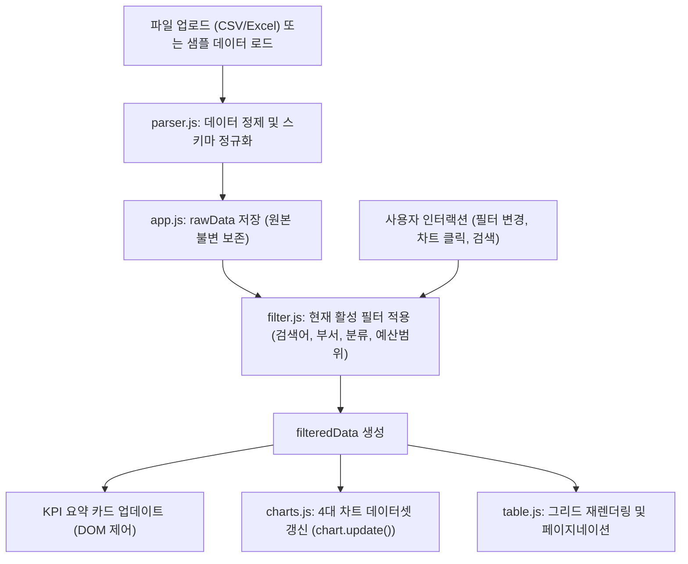

# [PRD] 예산 데이터 다차원 분석 및 시각화 대시보드
**Budget Data Multi-Dimensional Analytics & Visualization Dashboard**

---

| 문서 버전 | v1.0.0 | 작성일자 | 2026-10-16 |
| :--- | :--- | :--- | :--- |
| 작성자 | AI 시스템 설계팀 | 프로젝트 상태 | 기획 및 요구사항 확정 (Draft) |
| 대상 파일 | `예산자료.csv` 및 동등 규격의 Excel(.xlsx, .xls) / CSV | 배포 위치 | `/web` |

---

## 1. 프로젝트 개요 및 배경

### 1.1 배경
공공기관, 지자체 및 유관 진흥원에서는 매년 수십~수백 건의 정책 사업 및 예산을 편성하고 관리합니다. 현재 대부분의 예산 자료는 `예산자료.csv`와 같이 스프레드시트(Excel, CSV) 형식으로 다루어지고 있어 다음과 같은 한계가 존재합니다:
- **시각적 직관성 부족**: 텍스트와 숫자로 나열된 수백 개 행의 데이터를 통해 전체 예산 규모, 국비/시비/민자 매칭 비율, 분류별 집중도를 한눈에 파악하기 어렵습니다.
- **다차원 교차 분석의 번거로움**: "특정 부서가 주관하는 사업 중 공모사업 비율은 얼마인가?", "글로벌 선도 분야의 총 예산과 지원기능 분포는 어떠한가?"와 같은 복합적인 질문에 답하기 위해 매번 엑셀 피벗테이블이나 수식을 수작업으로 재작성해야 합니다.
- **보고 및 브리핑 한계**: 기획자 및 의사결정권자에게 보고 시 차트와 핵심 지표(KPI)를 실시간으로 탐색할 수 있는 대화형 인터페이스가 부재합니다.

### 1.2 목적
본 프로젝트는 **`예산자료.csv`와 같은 정형화된 예산 스프레드시트 파일을 드래그 앤 드롭으로 업로드하기만 하면**, 별도의 서버 설치나 복잡한 설정 없이 브라우저 환경에서 즉시 **분류별**, **부서별**, **예산/재원별** 다차원 시각화 차트와 인터랙티브 데이터 탐색 테이블을 제공하는 모던 웹 대시보드를 구축하는 것을 목적으로 합니다.

---

## 2. 목표 및 핵심 성공 지표 (KPI & Success Metrics)

| 목표 항목 | 세부 목표치 | 측정 기준 |
| :--- | :--- | :--- |
| **즉시성 (Instant Loading)** | 파일 업로드 후 **1초 이내** 대시보드 렌더링 | 1,000건 미만 레코드 기준 브라우저 내 파싱 및 차트 생성 속도 |
| **데이터 호환성** | CSV(UTF-8, EUC-KR) 및 Excel(.xlsx, .xls) 100% 지원 | 샘플 `예산자료.csv` 및 관련 파일 무오류 로드 |
| **보안성 (Data Privacy)** | **100% 클라이언트 사이드 처리** (Zero Server Upload) | 외부 네트워크로 예산 데이터 전송 없음 (사내 보안 준수) |
| **탐색성 (Usability)** | 3-클릭 이내 원하는 세부 사업 도출 | 실시간 필터(분류, 부서, 예산범위, 키워드 검색) 연동 |

---

## 3. 데이터 명세 및 파싱 규칙 (Data Specification)

### 3.1 기준 데이터 구조 (`예산자료.csv`)
대시보드가 수용하는 표준 스키마는 다음과 같습니다:

| 컬럼명 | 데이터 타입 | 필수 여부 | 예시 값 | 설명 |
| :--- | :--- | :---: | :--- | :--- |
| **연번** | Number/String | 선택 | `1`, `2` | 레코드 고유 식별자 |
| **대분류** | String | 필수 | `글로벌 선도`, `디지털 전환` | 정책 및 사업 전략 대분류 |
| **중분류** | String | 선택 | `1-1. [기술] 글로벌 미래...` | 대분류 하위 세부 전략 과제 |
| **소분류** | String | 선택 | `양자정보`, `클라우드` | 세부 기술/사업 분야 |
| **지원기능** | String | 선택 | `산업기반 조성, 기술혁신` | 다중 선택 가능(쉼표 구분) |
| **사업명** | String | 필수 | `양자정보기술 생태계 산업 활성화` | 개별 지원 사업 명칭 |
| **사업유형** | String | 선택 | `위/수탁`, `공모사업`, `자체사업` | 사업 성격 구분 |
| **위/수탁, 공모사업, 자체사업** | String (○/-) | 선택 | `○`, `-` | 체크 매트릭스 컬럼 |
| **부산시 소관부서** | String | 필수 | `인공지능소프트웨어과` | 상위 지자체 주무 부서 |
| **진흥원 담당부서** | String | 필수 | `AI·AX단`, `디지털융합단` | 실무 수행/전담 부서 |
| **국비 (백만원)** | Number | 필수 | `0.0`, `87.8`, `1200.0` | 중앙정부 지원 예산 |
| **시비 (백만원)** | Number | 필수 | `600.0`, `180.0` | 지방자치단체 매칭 예산 |
| **기타/민자 (백만원)** | Number | 필수 | `0.0`, `415.0` | 민간 부담금 및 기타 재원 |
| **총예산 (백만원)** | Number | 필수 | `600.0`, `1,215.0` | 합계 예산 (`국비 + 시비 + 기타/민자`) |
| **재원 내역 상세** | String | 선택 | `시비 600`, `국비 90, 시비 90` | 재원 구성 상세 텍스트 |
| **주요 지원 내용** | String | 선택 | `지역 양자산업 생태계 조성...` | 사업 세부 개요 및 지원 내용 |

### 3.2 파싱 및 정제(Cleansing) 규칙
1. **헤더 유연 매핑 (Header Normalization)**
   - 헤더 텍스트의 줄바꿈(`\n`), 공백, 괄호 단위 표기(`(백만원)`)를 정규화하여 자동 인식.
   - 예: `"2026년 총예산\n(백만원)"` $\rightarrow$ `총예산` 키로 매핑.
2. **숫자 필드 안전 변환**
   - 천 단위 쉼표(`,`), 공백, 하이픈(`-`), 통화 기호(`₩`) 제거 후 `parseFloat` 처리. 결측치나 변환 불가 값은 `0.0`으로 기본 보정.
3. **인코딩 자동 감지**
   - CSV 파일의 경우 한글 인코딩 깨짐을 방지하기 위해 UTF-8 및 CP949(EUC-KR) 디코딩 자동 처리.

---

## 4. 사용자 페르소나 및 핵심 유스케이스

### 4.1 페르소나
- **예산 총괄 기획자 (Manager Kim)**: 전체 총예산 규모와 재원별(국비 vs 시비) 의존도를 점검하고 경영진 보고용 지표를 신속히 산출해야 함.
- **실무 부서장 (Lead Park)**: 자신의 부서(`AI·AX단`)가 맡은 사업 수와 총 예산 현황, 공모사업 대비 자체/수탁사업 비중을 실시간 필터링하여 확인하고자 함.
- **예산 심의관/의사결정권자 (Director Lee)**: 10억 이상 대형 사업, 특정 전략 분야(예: 양자, 클라우드)에 예산이 집중된 양상을 직관적인 그래프로 파악하고자 함.

### 4.2 핵심 유스케이스 흐름
1. 사용자가 웹 브라우저 접속 후 `예산자료.csv` 또는 엑셀 파일을 드래그하여 업로드 영역에 놓는다. (또는 '기본 샘플 데이터 불러오기' 클릭)
2. 대시보드가 상단에 총 예산, 총 사업 수, 국비/시비/민자 비율 등의 핵심 KPI 카드를 즉시 표시한다.
3. 사용자가 [분류별 분석], [부서별 분석], [예산별 분석] 탭 또는 토글을 이동하며 동적 차트를 탐색한다.
4. 특정 분류(예: "글로벌 선도") 또는 부서(예: "AI·AX단")를 클릭하면 연관된 모든 차트와 하단 데이터 테이블이 실시간 동기화(Cross-Filtering)된다.
5. 필요한 조건으로 필터링된 결과 데이터를 CSV 또는 Excel로 다운로드한다.

---

## 5. 상세 기능 요구사항 (Functional Requirements)

### 5.1 F-1. 파일 업로드 및 데이터 연동
- **F-1.1 드래그 앤 드롭 파일 업로더**: Drag & Drop 영역 및 파일 탐색기 연동.
- **F-1.2 멀티 포맷 지원**: `.csv`, `.xlsx`, `.xls` 파일 자동 파싱.
- **F-1.3 샘플 데이터 원클릭 로드**: 파일이 없는 사용자를 위해 기본 내장된 `예산자료.csv`를 1초 만에 로드하는 '샘플 데이터로 체험하기' 버튼 제공.
- **F-1.4 데이터 유효성 검사**: 필수 컬럼 누락 여부 확인 및 파싱 상태 알림(오류 행 건수, 정상 행 건수 표시).

### 5.2 F-2. 종합 요약 지표 (KPI Cards)
- **F-2.1 총 예산 규모**: 총 사업 예산 합계(백만원 $\rightarrow$ 억원/조 단위 환산 표기 병행).
- **F-2.2 총 사업 수**: 등록된 총 사업 과제 건수.
- **F-2.3 재원 구성비**: 국비, 시비, 기타/민자 예산 총액 및 각각의 점유율(%).
- **F-2.4 평균 사업 규모**: 사업당 평균 예산액 및 최대 단일 사업 예산액.

### 5.3 F-3. [분류별] 심층 분석 (Classification View)
- **F-3.1 대분류별 예산 및 사업 수**:
  - 도넛 차트(Donut Chart) 및 수평 바 차트를 통해 대분류별 예산 점유율 시각화.
- **F-3.2 중분류/소분류 드릴다운 트리맵/바 차트**:
  - 대분류 선택 시 중분류/소분류로 단계적 확장 분석 지원.
- **F-3.3 지원기능 및 사업유형 분포**:
  - 기술혁신, 산업기반 조성, 인재양성 등 주요 기능별 예산 규모 분석.
  - 위/수탁 vs 공모사업 vs 자체사업 비중 분석.

### 5.4 F-4. [부서별] 심층 분석 (Department View)
- **F-4.1 부산시 소관부서별 예산 현황**:
  - 상위 시청 소관부서(예: 인공지능소프트웨어과 등)별 총 예산 랭킹.
- **F-4.2 진흥원 담당부서별 예산 및 재원 구성**:
  - 수행 부서(예: AI·AX단, 디지털융합단 등)별 누적 막대 차트(Stacked Bar Chart: 국비/시비/민자 분할 표시).
- **F-4.3 부서별 사업 포트폴리오 매트릭스**:
  - 부서별 관리 사업 건수 vs 평균 사업 예산 산점도 또는 순위 테이블.

### 5.5 F-5. [예산/재원별] 심층 분석 (Budget View)
- **F-5.1 재원 구조 비교 (국비 vs 시비 vs 기타/민자)**:
  - 전체 재원 구조 파이 차트 및 부서/분류별 국비 확보율(매칭비) 순위.
- **F-5.2 예산 규모별 사업 구간 분포**:
  - 대형 사업(10억 원 이상), 중형 사업(5억~10억), 소형 사업(1억~5억), 단위 사업(1억 미만) 구간별 사업 건수 히스토그램.
- **F-5.3 Top 10 최대 예산 사업 랭킹**:
  - 단일 사업 기준 가장 예산이 큰 10대 메가 프로젝트 순위 및 상세 카드.

### 5.6 F-6. 스마트 필터링 및 검색 (Interactive Filter)
- **F-6.1 다중 조건 필터**:
  - 대분류 드롭다운(전체 / 개별 선택)
  - 소관부서 및 담당부서 드롭다운
  - 사업유형(공모, 위수탁, 자체) 체크박스
  - 예산 범위 슬라이더(최소 ~ 최대)
- **F-6.2 통합 실시간 검색**:
  - 사업명, 세부 지원 내용, 소분류 키워드에 대한 즉시 필터링(Debounced Search).
- **F-6.3 필터 리셋 버튼**: 원클릭으로 모든 조건을 초기화하여 전체 데이터로 복귀.

### 5.7 F-7. 데이터 그리드 및 상세 모달 (Data Table & Detail View)
- **F-7.1 반응형 인터랙티브 테이블**:
  - 컬럼 정렬(Sort by 연번, 사업명, 총예산, 부서 등).
  - 페이지당 행 수 선택(10, 25, 50, 100건) 및 페이지네이션.
- **F-7.2 상세 모달(Pop-up Modal)**:
  - 특정 사업 행 클릭 시 `주요 지원 내용`, `재원 내역 상세`, `담당 부서` 등 전체 정보를 깔끔한 카드 형태로 팝업 표시.

### 5.8 F-8. 내보내기 및 유틸리티 (Export)
- **F-8.1 엑셀/CSV 내보내기**: 현재 화면에서 필터링된 결과 데이터셋을 그대로 엑셀(`.xlsx`) 또는 `.csv`로 다운로드.
- **F-8.2 차트 이미지 저장**: 개별 차트 또는 대시보드 캡처 PNG 다운로드 기능.

---

## 6. UI/UX 디자인 및 레이아웃 구조

### 6.1 화면 구성도 (Wireframe Layout)

```
+-----------------------------------------------------------------------------------------+
| [LOGO] 예산 분석 & 시각화 대시보드         [샘플 데이터 로드] [파일 업로드] [엑셀 다운로드]  |
+-----------------------------------------------------------------------------------------+
| [KPI 1: 총 사업예산]      [KPI 2: 총 사업 수]      [KPI 3: 국비/시비 비율]   [KPI 4: 최대 예산 사업]  |
|  23,450 백만원 (234.5억)     48개 과제              국비 45% : 시비 55%     지역 데이터센터...    |
+-----------------------------------------------------------------------------------------+
| [검색창: 사업명/내용] [대분류 선택 v] [담당부서 선택 v] [사업유형 v] [예산 범위 슬라이더] [초기화] |
+-----------------------------------------------------------------------------------------+
| [탭: 종합 대시보드]  |  [탭: 분류별 분석]  |  [탭: 부서별 분석]  |  [탭: 재원별 분석]  |  [탭: 사업 목록] |
+-----------------------------------------------------------------------------------------+
|                                                                                         |
|  [차트 A: 대분류별 예산 점유율 (도넛)]           [차트 B: 담당부서별 예산 스택 막대]          |
|  (Interactive Hover & Click to Filter)        (국비/시비/민자 구분)                     |
|                                                                                         |
+-----------------------------------------------------------------------------------------+
|  [차트 C: 예산 규모별 분포 (히스토그램)]          [차트 D: Top 10 최대 예산 사업 목록]          |
|                                                                                         |
+-----------------------------------------------------------------------------------------+
| [데이터 테이블: 실시간 필터링 결과 48건 중 48건 표시]                           [컬럼 설정]  |
| 연번 | 대분류 | 사업명 | 담당부서 | 국비(백만) | 시비(백만) | 총예산(백만) | 상세조회        |
|  1  | 글로벌...| 양자정...| AI·AX단  |    0.0    |   600.0   |   600.0   | [상세보기]      |
| ...                                                                                     |
+-----------------------------------------------------------------------------------------+
```

### 6.2 UX 원칙
- **Clean & Trustworthy Design**: 공공/금융 데이터의 특성에 부합하는 깔끔한 블루/인디고/슬레이트 톤의 모던 인터페이스.
- **인터랙티브 크로스 필터링**: 차트 조각(도넛 파이, 바)을 클릭하면 해당 조건으로 전체 화면 데이터가 부드럽게 필터링됨.
- **다크 모드 / 라이트 모드 지원**: 사용자 선호도에 따른 테마 전환 지원.

---

## 7. 기술 스택 및 아키텍처 제안

### 7.1 확정 기술 스택 (Zero-Build, Pure Vanilla JavaScript SPA)
별도의 Node.js 빌드 도구(Vite, Webpack 등)나 무거운 프런트엔드 프레임워크(React, Vue, Angular 등) 없이, **순수 웹 표준 기술(HTML5, CSS3, Vanilla ES6+ JavaScript)**만으로 구현합니다. 이를 통해 더블 클릭하거나 로컬 웹서버에서 즉각 실행할 수 있는 초경량·고성능 구조를 달성합니다.

- **Core Runtime**: 순수 웹 브라우저 (Chrome, Edge, Safari, Firefox 등 표준 브라우저 지원)
- **언어 & 프레임워크**: **Vanilla JavaScript (ES6+ Native Modules)**
- **UI & 스타일링**: 
  - **Tailwind CSS (CDN)**: 빌드 과정 없는 빠른 반응형 스타일링
  - **Lucide Icons / Heroicons**: 직관적인 UI 아이콘
  - **Custom CSS (`style.css`)**: 스크롤바, 모달 애니메이션 및 미세 인터랙션
- **시각화 엔진**: **Chart.js (v4 CDN)**
  - 경량 및 높은 렌더링 성능, 모바일/태블릿 반응형 차트 기본 지원
  - 도넛 차트, 누적 막대 차트(Stacked Bar), 수평 막대 차트 등 구현
- **파일 파서 (File Parsers via CDN)**:
  - CSV: **PapaParse (v5 CDN)** - 스트리밍 및 대용량 CSV 고속 파싱, 자동 인코딩 감지
  - Excel: **SheetJS (xlsx.full.min.js CDN)** - 바이너리 엑셀(.xlsx, .xls) 브라우저 내 즉각 JSON 변환
- **내보내기**: SheetJS + 브라우저 내장 Blob / Download API

### 7.2 프로젝트 파일 구조 (Vanilla JS Module Architecture)
유지보수성과 가독성을 위해 기능별로 명확히 모듈을 분리합니다:

```
web/
├── PRD.md                 # 제품 요구사항 정의서 (현재 문서)
├── index.html             # 메인 HTML 구조 (Tailwind & CDN 라이브러리 로드)
├── css/
│   └── style.css          # 커스텀 스타일, 테마 및 애니메이션
└── js/
    ├── app.js             # 메인 진입점, 글로벌 상태(State Store) 및 이벤트 오케스트레이션
    ├── parser.js          # CSV 및 Excel 파일 파싱, 컬럼 정규화, 데이터 정제 로직
    ├── filter.js          # 다중 조건 필터링, 실시간 키워드 검색 엔진
    ├── charts.js          # Chart.js 인스턴스 생성, 갱신 및 차트 클릭 상호작용
    └── table.js           # 데이터 테이블 렌더링, 정렬, 페이지네이션, 상세 모달
```

### 7.3 데이터 흐름 및 상태 관리 패턴 (Reactive State Pattern)
바닐라 JS에서 프레임워크의 반응형(Reactivity)을 모방하기 위해 **중앙 집중식 단방향 상태 흐름(Unidirectional State Store)**을 적용합니다:



1. **상태 객체 (App State)**:
   - `rawData`: 원본 데이터셋 (불변 유지)
   - `filteredData`: 현재 필터 조건이 적용된 파생 데이터셋
   - `filters`: `{ search: '', category: 'all', department: 'all', type: 'all', budgetMin: 0, budgetMax: Infinity }`
   - `pagination`: `{ currentPage: 1, pageSize: 10, sortBy: '연번', sortOrder: 'asc' }`
2. **이벤트 디스패치**:
   - 필터나 검색어가 변경되면 `applyFilters()`가 호출되고, 이에 따라 `renderKPI()`, `updateCharts()`, `renderTable()`이 순차적으로 실행되어 항상 일관된 UI 동기화를 보장합니다.

---

## 8. 단계별 개발 로드맵 (Milestones)

| 단계 | 주요 작업 내용 | 예상 산출물 |
| :---: | :--- | :--- |
| **Phase 1** (완료) | • 요구사항 분석 및 PRD 작성<br>• 바닐라 JS 기반 무빌드/경량 기술 스택 확정 | `web/PRD.md` |
| **Phase 2** | • `web` 디렉토리 기반 메인 레이아웃 구성 (`index.html`)<br>• PapaParse / SheetJS 기반 파일 파서 (`parser.js`) 구현<br>• 샘플 `예산자료.csv` 자동 로드 기능 구현 | `index.html`<br>`js/parser.js` |
| **Phase 3** | • 종합 KPI 카드 렌더링 로직 작성<br>• Chart.js 연동 (`js/charts.js`): 대분류 도넛, 부서별 스택 바, 예산 히스토그램, Top 10 바<br>• 탭 전환 인터페이스 (종합/분류별/부서별/예산별) | `js/charts.js` |
| **Phase 4** | • 다중 필터 & 실시간 검색 엔진 (`js/filter.js`)<br>• 데이터 테이블 정렬/페이지네이션 및 사업 상세 모달 (`js/table.js`)<br>• 필터링된 결과 엑셀/CSV 다운로드 기능 | `js/filter.js`<br>`js/table.js` |
| **Phase 5** | • 크로스 브라우징 및 반응형 검증<br>• 다양한 엑셀/CSV 파일 업로드 예외 처리 테스트 | 최종 안정화 및 가이드 |

---

## 9. 기대 효과 및 결론
- **업무 효율 극대화**: 기존 엑셀 수작업 집계 대비 데이터 분석 및 시각화 소요 시간을 **95% 이상 단축**.
- **의사결정 지원**: 부서별 예산 배분의 적정성, 국비 유치 성과, 특정 기술 분야에 대한 투자 집중도를 직관적인 시각 자료로 즉각 브리핑 가능.
- **보안 및 설치 편의성**: 별도의 데이터베이스나 서버 설치 없이 브라우저에서 단독 구동되므로, 보안에 민감한 기관 내부 예산 자료를 안전하게 분석 가능.
